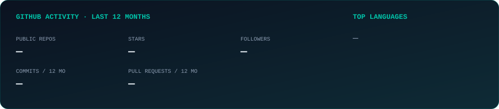

  

  
  
  
  

<a href="#-about-me">About</a> · <a href="#-selected-projects">Projects</a> · <a href="#-experience">Experience</a> · <a href="#-tech-stack">Stack</a> · <a href="#-activity">Activity</a>

> [!IMPORTANT]
> **Open to work:** PFE internship for 5–6 months, starting January/February 2027, in Software Engineering / DevOps / Cloud & Infrastructure. Based in Bizerte, Tunisia. Contact me by [email](mailto:nsibidhiaelhack@gmail.com).

## 👋 About me

I’m a final-year engineering student at **ENISo** (École Nationale d'Ingénieurs de Sousse), building software and infrastructure automation across development, DevOps and cloud.
My differentiator is a strong **Networks & Systems** background, including **MPLS/VPN, BGP and OSPF**.
I’m deepening **Java full-stack** development with **Spring Boot** and **Angular**.
Founder and President of the **ACM student chapter at ENISo**. Languages: Arabic (native), French (fluent) and English (fluent).

## 🚀 Selected projects

<table>
<tr>
<td width="50%" valign="top">

### [DevSecOps CI/CD Pipeline](https://github.com/dhiaelhack/devsecops_E-commerce_PS)
Full-stack platform with GitLab CI/CD, Docker, SonarQube and OWASP ZAP, deployed on Microsoft Azure with MongoDB Atlas.

**Impact:** Integrated quality and security checks into the delivery pipeline. <!-- TODO(dhia): Add verified pipeline stage and scan counts. -->

`GitLab CI/CD` `Docker` `SonarQube` `OWASP ZAP` `Azure` `MongoDB Atlas`

**Links:** [Code](https://github.com/dhiaelhack/devsecops_E-commerce_PS)
</td>
<td width="50%" valign="top">

### [VPN-MPLS Network Architecture](https://dhiaelhack.dev)
Multi-site MPLS/VPN backbone emulated with GNS3, Docker and FRRouting, implementing OSPF, BGP and MP-BGP and validating routing and label switching with Wireshark.

**Impact:** Validated OSPF, MP-BGP VPN routes and MPLS label switching across the emulated network, verified with Wireshark captures.

`GNS3` `Docker` `FRRouting` `OSPF` `BGP` `MP-BGP` `Wireshark`

**Links:** [Project overview](https://dhiaelhack.dev)
</td>
</tr>
<tr>
<td width="50%" valign="top">

### [HuginnWatch — Network & Server Security Monitoring](https://github.com/dhiaelhack/HuginnWatch)
Infrastructure monitoring platform with FastAPI and Streamlit for Nmap vulnerability scans, alerting and telemetry anomaly detection.

**Impact:** Combines vulnerability scanning, alerting and telemetry analysis. <!-- TODO(dhia): Add verified scan, alert and telemetry counts. -->

`FastAPI` `Streamlit` `Nmap`

**Links:** [Code](https://github.com/dhiaelhack/HuginnWatch)
</td>
<td width="50%" valign="top">

### [Agentic RAG Assistant](https://github.com/dhiaelhack/RAG_LOCAL)
Document question-answering system using LangChain and a ReAct agent, with retrieval quality, tool use and failure cases analyzed using LangSmith.

**Impact:** Evaluates retrieval quality, tool use and failure cases. <!-- TODO(dhia): Add verified document and evaluation counts. -->

`LangChain` `ReAct` `Pinecone` `LangSmith`

**Links:** [Code](https://github.com/dhiaelhack/RAG_LOCAL)
</td>
</tr>
</table>

<b>Other projects</b>

- **LAS Shell** — Unix shell in C covering processes, IPC, pipelines, redirections, signals, background jobs, history and aliases. [Code](https://github.com/dhiaelhack/LAS_Shell_DSH)
- **Real-time facial recognition** — Detection and recognition pipeline with Flask, OpenCV and TensorFlow, trained and tested on custom images. [Code](https://github.com/dhiaelhack/FaceRecog-WebApp)
- **Smart solar tracker** — Autonomous ESP32 solar orientation prototype using LDR sensors and servo motors in C/C++.
- **Real-time GSM/GPS vehicle tracking** — SIM800L-based system for position transmission, live mapping and trip history.
- **AI-assisted integrated antenna systems** — Literature review of AI/ML approaches applied to integrated antennas.
- **SOTULUB Network Lab** — Containerized eight-node MPLS-VPN topology using FRRouting and Docker Compose, with OSPF, LDP and VRF configuration; MP-BGP is in progress. [Code](https://github.com/dhiaelhack/sotulub-network)

## 💼 Experience

- **Jul – Aug 2026** · **Network & Systems Administration Intern** · SOTULUB (Tunisia) Administration and supervision of network and system infrastructure; troubleshooting and maintenance. <!-- TODO(dhia): Add a measurable result from this internship. -->
- **Jul – Aug 2025** · **Software Development Intern, Network Supervision** · SOTETEL (Tunisia) Developed a network supervision software component within the data center team, in collaboration with network administrators. <!-- TODO(dhia): Add a measurable result from this internship. -->
- **2025 – Present** · **Founder & President** · ACM Student Chapter, ENISo Obtained official ACM chapter affiliation and established its organization; organizes technical and programming events. <!-- TODO(dhia): Add a measurable chapter outcome. -->

## 🛠️ Tech stack

| Category | Technologies |
|---|---|
| **DevOps & Cloud** | Git · GitLab CI/CD · Docker · Microsoft Azure · SonarQube · Grafana · Prometheus |
| **Networks & Systems** | Linux · OSPF · BGP · MP-BGP · MPLS/VPN · GNS3 · FRRouting · Wireshark |
| **Development** | Python (FastAPI, Flask) · Java (Spring Boot) · JavaScript/TypeScript (Node.js/Express, Angular) · Scala · MongoDB / MongoDB Atlas |
| **Security** | OWASP ZAP · Nmap · pfSense |
| **AI & Data** | LangChain (ReAct agents, RAG) · Pinecone · LangSmith · TensorFlow · OpenCV |
| **Embedded** | C/C++ · ESP32 · STM32 · Raspberry Pi · SIM800L · POSIX C (processes, IPC, signals) |

## 🏅 Certifications & activities

- **NVIDIA Deep Learning Institute** certificate — Natural Language Processing
- Active member of **Eureka Club** and **Orange Digital Center Club**
- Hackathon participant — embedded systems, IoT and AI

## 📈 Activity

Contribution snake

<picture>
  <source media="(prefers-color-scheme: dark)" srcset="https://raw.githubusercontent.com/dhiaelhack/dhiaelhack/output/github-snake-dark.svg" />
  <source media="(prefers-color-scheme: light)" srcset="https://raw.githubusercontent.com/dhiaelhack/dhiaelhack/output/github-snake.svg" />
  
</picture>

  

